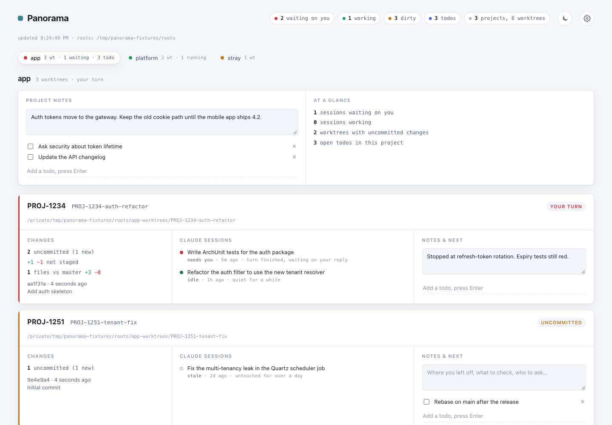

# Panorama

A local dashboard that answers one question: across all your projects, where is
your attention needed? It shows every git worktree you have checked out, the
Claude Code sessions running inside each one, and the notes and todos you pin
to them, sorted by what needs you most.



It joins three sources you already have:

| Source | Gives you |
| --- | --- |
| `git worktree list` across your project folders | which branches are checked out where, and what's changed |
| `~/.claude/projects/*/*.jsonl` | which Claude Code sessions ran in which directory, and their status |
| a local SQLite file | your notes and todos, pinned per project and per worktree |

Git is only ever read from. Nothing leaves your machine: the server listens on
`127.0.0.1` only and answers only requests addressed to `127.0.0.1` or
`localhost`, and there is no account, telemetry or network call.

**Runs on macOS and Linux.** Windows is not supported. You need `git`, and
Claude Code for the session half of the board.

## Install

On a Mac, the app is the easiest. Elsewhere, pick a binary or run from source,
and configure before the first start (next section): without a config
Panorama scans `~/work` only.

### Option A: the Mac app

Download the `.dmg` for your Mac from the
[latest release](https://github.com/kevalo-be/panorama/releases/latest):
`Panorama-<version>-arm64.dmg` for Apple Silicon, `Panorama-<version>-x86_64.dmg`
for Intel. Open it and drag Panorama to Applications. It needs macOS 13 or
later.

The app is signed and notarized by Apple, so it opens without warnings. It
shows the board in its own window, starts its own server on a free port while
it is open, and stops it when you quit. Set your project folders on its
Settings page (Panorama → Settings…, or ⌘,); they are saved to
`~/.config/panorama/panorama.env`. To start it at login, choose
*Panorama → Open at Login*. Its log is in `~/Library/Logs/Panorama/`.

### Option B: download the binary

One file with Python and everything else bundled, about 15 MB. Pick the asset
for your machine from the [latest release](https://github.com/kevalo-be/panorama/releases/latest):

| Machine | Asset |
| --- | --- |
| Mac with Apple Silicon | `panorama-<version>-macos-arm64` |
| Mac with Intel | `panorama-<version>-macos-x86_64` |
| Linux, x86_64 | `panorama-<version>-linux-x86_64` |

```bash
V=0.2.0                       # the version you are installing
A=panorama-$V-macos-arm64     # your asset from the table
curl -LO https://github.com/kevalo-be/panorama/releases/download/v$V/$A
curl -LO https://github.com/kevalo-be/panorama/releases/download/v$V/SHA256SUMS
shasum -a 256 -c SHA256SUMS --ignore-missing    # Linux: sha256sum -c ...
chmod +x $A
mkdir -p ~/.local/bin && mv $A ~/.local/bin/panorama
```

`~/.local/bin` is not on the `PATH` by default on macOS. Add it to your shell
profile, or start the binary by its full path.

The macOS binaries are signed and notarized by Apple, so they also run when
downloaded with a browser. Every binary is built by CI from the source tagged in this repository, tested
before release, and listed in `SHA256SUMS`.

### Option C: run from source with uv

[uv](https://docs.astral.sh/uv/) reads the dependencies declared at the top of
`app.py`, so there is no virtualenv to manage.

```bash
brew install uv git            # or your package manager
git clone https://github.com/kevalo-be/panorama && cd panorama
```

### Option D: plain Python

Python 3.10 or newer, in a virtualenv (Homebrew and recent Debian/Ubuntu refuse
a global `pip install`):

```bash
git clone https://github.com/kevalo-be/panorama && cd panorama
python3 -m venv .venv && . .venv/bin/activate
pip install -r requirements.txt
```

## Configure

The easiest way is the **Settings** page: click the gear in the board's header,
or open http://127.0.0.1:8787/settings (in the Mac app: Panorama → Settings…,
or ⌘,). It shows every option below with its
current value and where that value comes from, and saving writes it to
`panorama.env` for you, keeping your comments. Most options apply on the next
refresh; the port and the database path apply after a restart. An option set as
a real environment variable is shown read-only there, because the variable
wins over the file.

You can also edit the file by hand. Point Panorama at your own project folders
with a `panorama.env` file:

```bash
mkdir -p ~/.config/panorama
curl -L https://raw.githubusercontent.com/kevalo-be/panorama/main/panorama.env.example \
  -o ~/.config/panorama/panorama.env
$EDITOR ~/.config/panorama/panorama.env    # set PANORAMA_ROOTS at least
```

From a clone, `cp panorama.env.example panorama.env` works too. Panorama reads
the first file it finds, in this order:

1. the path in `$PANORAMA_ENV`
2. `panorama.env` in the directory you start Panorama from
3. `~/.config/panorama/panorama.env`

Real environment variables override the file. A hand edit is read at startup
only, so restart after editing the file directly. With no file at all, the
Settings page creates `~/.config/panorama/panorama.env` on the first save.

### Where your projects live

They don't have to share a folder. `PANORAMA_ROOTS` is colon-separated:

```
PANORAMA_ROOTS=~/work:~/projects:~/clients/acme
```

Each root is walked `PANORAMA_SCAN_DEPTH` levels deep looking for repos, and
scanning stops as soon as one is found. Worktrees are then discovered through
`git worktree list`, so they can sit anywhere on disk, including on another
volume. For the odd repo that fits no pattern at all, name it directly:

```
PANORAMA_REPOS=/Volumes/ext/old-project:~/Downloads/spike
```

| Variable | Default | Notes |
| --- | --- | --- |
| `PANORAMA_ROOTS` | `~/work` | colon-separated folders to scan |
| `PANORAMA_REPOS` | none | explicit repo paths, colon-separated |
| `PANORAMA_SCAN_DEPTH` | `3` | how deep to look for repos under each root |
| `PANORAMA_CLAUDE_DIR` | `~/.claude/projects` | Claude Code session logs |
| `PANORAMA_DB` | `~/.local/share/panorama/panorama.db` | your notes and todos |
| `PANORAMA_JIRA_BASE` | none | makes `ABC-123` in a branch name a link |
| `PANORAMA_CACHE_SECONDS` | `3` | floor on how often git gets shelled out to |
| `PORT` | `8787` | |

Your notes live in `PANORAMA_DB`, outside the code, so updating Panorama never
touches them. Copy that file to move your notes to another machine. There is no
sync built in, and syncing it through a cloud drive while two machines run will
corrupt it.

## Start

The Mac app starts its own server when you open it. Otherwise:

```bash
panorama            # option B
uv run app.py       # option C, inside the clone
python app.py       # option D, inside the clone with the venv active
```

On start, Panorama prints which `panorama.env` it loaded and which folders and
repos it scans, and flags any that don't exist. It creates its SQLite file and
tables at that point; there is no init command. Then open
http://127.0.0.1:8787, or the port you set in `PORT`.

## Run at login

### macOS: the Mac app

Choose *Panorama → Open at Login* in the app's menu. It appears under
*System Settings → General → Login Items*, where you can also switch it off.

### macOS: launchd, for the binary or a source checkout

`be.kevalo.panorama.plist` is a launchd job that starts Panorama at login and
restarts it if it dies. Its header comment says what to fill in:

- **With the binary,** make `ProgramArguments` a single string with the
  binary's full path, such as `/Users/<you>/.local/bin/panorama`. Set the
  working directory to `/Users/<you>/.config/panorama`, where your
  `panorama.env` lives.
- **From source,** set `__UV__` to the output of `which uv`, and
  `__PATH_TO_PANORAMA__` to your clone.

Then:

```bash
cp be.kevalo.panorama.plist ~/Library/LaunchAgents/
launchctl bootstrap gui/$(id -u) ~/Library/LaunchAgents/be.kevalo.panorama.plist
```

launchd reads the plist only when it loads the job, so after editing it,
reload:

```bash
launchctl bootout   gui/$(id -u)/be.kevalo.panorama
launchctl bootstrap gui/$(id -u) ~/Library/LaunchAgents/be.kevalo.panorama.plist
```

The job logs to `/tmp/panorama.log` and `/tmp/panorama.err`; look there first
if the board doesn't come up. If `bootstrap` fails with `Input/output error`, the old job hasn't finished
exiting yet. Wait a second and run it again. After editing `panorama.env` by
hand, or changing the port or database path in Settings, restart the job:

```bash
launchctl kickstart -k gui/$(id -u)/be.kevalo.panorama
```

### Linux: systemd

A user unit at `~/.config/systemd/user/panorama.service`:

```ini
[Unit]
Description=Panorama

[Service]
ExecStart=%h/.local/bin/panorama
WorkingDirectory=%h/.config/panorama
Restart=on-failure

[Install]
WantedBy=default.target
```

From source, use `ExecStart=/path/to/uv run app.py` and set
`WorkingDirectory=` to your clone. Logs go to `journalctl --user -u panorama`.

```bash
systemctl --user enable --now panorama
```

Don't reach for Docker here. Panorama reads host state: your git checkouts,
`~/.claude/projects`, and the host process list. In a container you'd
bind-mount all three and `lsof` still wouldn't see your `claude` processes.

## Run it as an app

On a Mac, the [Mac app](#option-a-the-mac-app) is the simplest way. With the
binary or from source, Panorama stays a localhost server, but your browser can
still give it its own window and Dock icon:

- **Standalone window.** With the server running, open Panorama
  in **Safari** and choose *File → Add to Dock*, in **Chrome** choose
  *Cast, save and share → Install page as app*, or in **Edge** choose
  *Apps → Install this site as an app*. Both use the bundled manifest and icon. Pair it
  with the login job above and it is just there.

## How to read the board

One tab per project. Every worktree of that project sits under its tab, so
starting to use worktrees adds rows inside a tab rather than new tabs. Tabs are
ordered by urgency and each carries a status pip plus a count of worktrees,
waiting sessions and open todos. Press `1`–`9` to switch, or click.

Colour means one thing throughout — the tab pip, the rail down the left edge of
each worktree, and the session dots all use the same scale:

| Colour | Meaning |
| --- | --- |
| **red**, blinking | a session is waiting on your reply or a permission prompt |
| **green**, breathing | a session is working right now |
| **green**, steady | a session ran here recently and finished |
| **amber** | no session active, but uncommitted changes are sitting there |
| **blue** | open todos, nothing else happening |
| **grey** | nothing going on |

Red is the only colour that blinks, because it's the only one that costs you
time when you miss it. A tab always shows the most urgent state below it, so you
never have to open one to find out whether it needs you. A session left for more
than a day stops counting as finished and the worktree falls back to showing its
git state — otherwise stale work reads as done.

Within a tab you get project-level notes and todos — for decisions and
conventions that outlive a single branch — alongside per-worktree notes for
where you left off. Branch names are matched against `ABC-123` to pull out a
ticket key.

Panorama never switches tabs on you while it polls, and never repaints a note
you're typing in.

The gear in the header opens the **Settings** page. It holds the theme,
*System* (follows your system appearance), *Light* or *Dark*, kept in sync with
the sun/moon button next to the gear, and the configuration described under
[Configure](#configure). Everything is stored server-side, never in the browser.
Coming back from Settings reloads the board on the most urgent tab.

## Things you'll want to tune

**The session status heuristic** lives in `classify()` in `app.py`. It's driven by
file mtime plus the shape of the last record:

```
< 45s                          -> running
< 15m, last record has a tool  -> needs-you (probably a permission prompt)
< 15m                          -> needs-you (turn finished, your move)
< 24h                          -> idle
else                           -> stale
```

The 15-minute boundary is the one to adjust first — if you often leave a session
sitting for half an hour and come back to it, raise it.

**The session log format.** `session_head()` and `session_tail()` parse defensively
and fall back to `None` rather than throwing, because the JSONL schema is not a
published contract.

**Process liveness** (`running_claude_pids`) uses `ps` + `lsof`, which works on
macOS and Linux but is best-effort. If it's noisy on your machine, drop the call
and rely on mtime alone.

## Ideas for later

- **GitLab MR status per branch.** One API call per branch with an open MR turns
  the lane header into "MR !412, 2 unresolved threads" — that's the piece that
  closes the ticket→branch→MR loop.
- **ntfy on transitions.** Diff the previous poll against the current one; when a
  session turns red, push a notification. Then you can stop looking at
  the page and let it come to you.
- **An *Open in IntelliJ* link per lane** that opens the worktree
  (`idea /path/to/worktree`) so the board becomes a launcher too.
- **Flag merged worktrees** whose branch is already in the base ref. Those are
  clutter and safe to suggest removing; Panorama would only suggest, never
  delete.

## Contributing

Issues and ideas are welcome. Panorama is developed in a separate private
repository; this one holds what you need to run it.

## License

[MIT](LICENSE)
